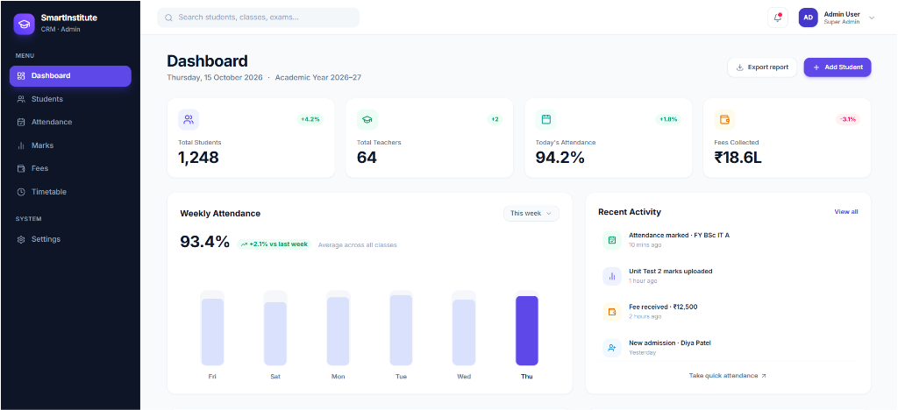

# SmartInstitute CRM — Complete Management Suite

<p align="center">
  
  
  
  
  
  
</p>

> **"Run your institute smarter, not harder."**  
> Admissions, attendance, marks, fees and faculty schedules — everything your institute needs, unified in one elegant, modern workspace.

---

## 📸 Application Preview

<p align="center">
  
</p>

---

## ⚡ 1-Click Launch (Windows)

No tedious manual terminal setup required! Simply double-click:
- **`run_project.bat`** (or **`start.bat`**): Automatically verifies Node.js, installs dependencies if needed, starts the Backend Database API (Port 5000), launches the Vite Frontend (Port 5173), and opens the app in your browser!
- **`stop_project.bat`**: Gracefully stops all running server processes with one click.

---

## 🚀 Key Modules & Capabilities

### 1. 📊 Executive Admin Dashboard
- **4 Real-time Stat Cards**: Total Students (1,248), Total Teachers (64), Today's Attendance (94.2%), and Fees Collected (₹18.6L).
- **Interactive Weekly Attendance Chart**: Day-by-day attendance trends across all divisions with current-day highlight.
- **Recent Activity Feed**: Real-time audit log of admissions, fee collections, and examination updates.
- **Class Breakdown**: Student counts, attendance progress bars, and average scores per division.

### 2. 👥 Student Directory & Lifecycle
- Instant search by student name, roll number, or parent contact.
- Filter by status (**Active**, **Alumni**) and division.
- Modal-based workflows to **Add**, **Edit**, and **Delete** student records.
- Color-coded attendance percentage badges and fee payment statuses.

### 3. 📅 Smart Attendance System
- Filter by Class, Subject, Date, and Lecture slot.
- One-click **"Mark all present"** bulk action.
- Segmented status switch (`Present` / `Absent` / `Late`) per student with real-time recalculation of stat cards.
- Inline editable student remarks (e.g., *"Medical leave"*, *"Late by 15 mins"*).

### 4. 📝 Marks Entry & Exam Analytics
- Class, Exam, Subject, and Max Marks selectors.
- Live statistical analysis: **Class Average**, **Highest Score**, **Lowest Score**, and **Pass Rate**.
- Automatic letter grade allocation (`A+`, `A`, `B+`, `B`, `C`, `F`) with dynamic percentage progress meters.
- Grade distribution breakdown chart.

### 5. 💳 Fees, Ledger & Receipts
- Outstanding dues tracker and collection reconciliation.
- Record payment modal with instant receipt number generation (`REC-2026-XXXX`).
- Multi-channel payment recording (UPI, Net Banking, Cash, Cheque).

### 6. 🎓 Student & Teacher Portals
- **Student View**: Digital Student ID preview, subject-wise attendance breakdown, downloadable report cards, and receipt ledger.
- **Faculty View**: Assigned subject schedules, division rosters, and class timetable matrix.

---

## 🛠️ Technology Stack

- **Frontend**: React 19, TypeScript, Vite 8, Tailwind CSS v4
- **UI Components & Icons**: Lucide React
- **Backend API**: Node.js, Express 5, CORS, Dotenv
- **Database**: MySQL 8.0+ (via `mysql2/promise`) with embedded SQLite fallback (`better-sqlite3`)
- **State & Sync**: Optimistic React Context state with LocalStorage persistence and automated REST API synchronization

---

## 💻 Manual Setup & Local Development

### 1. Prerequisites
- **Node.js** (v18 or later recommended)
- **MySQL** (optional; defaults to local database)

### 2. Clone Repository
```bash
git clone https://github.com/mukundkumar2153/SmartInstitute-CRM.git
cd SmartInstitute-CRM
```

### 3. Configure Environment Variables
Copy `.env.example` to `.env`:
```bash
cp .env.example .env
```
Update your MySQL database credentials inside `.env`:
```env
DB_HOST=localhost
DB_PORT=3306
DB_USER=root
DB_PASSWORD=your_mysql_password
DB_NAME=smartinstitute_crm
PORT=5000
```

### 4. Install Dependencies & Seed Database
```bash
# Install root & server dependencies
npm install

# Initialize MySQL tables & seed data (optional)
node server/seed_mysql.js
```

### 5. Run the Application
In separate terminal windows:
```bash
# Terminal 1: Start Backend API (Port 5000)
npm run server

# Terminal 2: Start Vite Dev Server (Port 5173)
npm run dev
```
Open **[http://localhost:5173/](http://localhost:5173/)** in your browser.

---

## 📁 Project Structure

```
SmartInstitute-CRM/
├── public/                 # Static assets & favicon
├── screenshots/            # Showcase images for README
│   └── dashboard.png       # Admin dashboard screenshot
├── server/                 # Express backend & DB controllers
│   ├── db.js               # SQLite database provider
│   ├── db_mysql.js         # MySQL connection pool
│   ├── mysql_schema.sql    # Relational database schema
│   ├── seed_mysql.js       # Initial seed script
│   └── server.js           # REST API routes
├── src/
│   ├── assets/             # Brand logos & graphics
│   ├── components/         # Reusable layouts, headers, modals
│   ├── context/            # AppContext state & API sync
│   ├── data/               # Mock datasets & fallback records
│   ├── pages/              # Portal pages (Dashboard, Attendance, Marks, etc.)
│   └── types/              # TypeScript interfaces & types
├── .env.example            # Environment variables template
├── run_project.bat         # 1-Click Windows startup script
├── stop_project.bat        # 1-Click shutdown script
└── package.json            # Project dependencies & scripts
```

---

## 📄 License
This project is open-source and available under the [MIT License](LICENSE).
